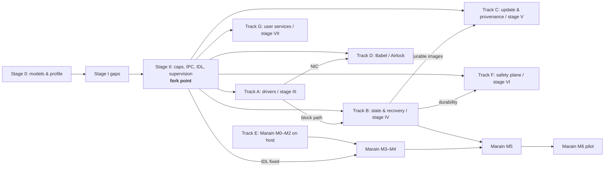

# MIND CORE — Roadmap v1.10

**Version:** 1.10 (1.9 → 1.10: the current state brought up to date with the code, 000-KRN-0106 — section 2, and in section 3 what changed since K3, K4, C1 and C7; 1.8 → 1.9: the current state of stages IV and V — track B's block store through checkpoints, main tasks 300–306, and track C's signed boot volumes, releases and Secure Boot in QEMU, main task 350 and tasks of 351; 1.7 → 1.8: C6 — the supervisor is separated from the bootstrap authority as far as privileges go (issue 170: init keeps the privileges it grants in escrow and holds no process control) and has a memory reserve for recovery (issue 169); task memory is charged to its spawner (issue 168); 1.6 → 1.7: the assurance models of revoke and MOVE are checked by TLC — issue 167, `docs/assurance` — and found a kernel bug, fixed; 1.5 → 1.6: track H adds the pins of ARM boards — pin controllers from the firmware's tables, a `gpio` service, hardware tables in `hwdocs/` outside the image, issues 206–207, and the `pins` tool of track G; 1.4 → 1.5: track H has the aarch64 platform `aarch64/QEMU-virt-0`, issues 200–204; boards are next, issue 205; 1.3 → 1.4: track H, porting to other architectures, starting with aarch64; 1.2 → 1.3: track D has a network stack, a policy broker and a TLS service with a key service; 1.1 → 1.2: stage II steps C1–C8 done; tracks A and D started with the VirtIO network driver)  
**Date:** 20 October 2026  
**Based on:** [Constitution v1.6](constitution/EN/MIND_CORE_Constitution_v1.6.md) and [RFC 001 Marain v0.4](constitution/EN/RFC_001_Marain_v0.4.md)  
**Russian version:** [ROADMAP_RU.md](ROADMAP_RU.md) (kept in sync; the English text is the reference)

This roadmap derives the order of work from the project's founding documents in [`constitution/`](constitution/) (English in [`constitution/EN`](constitution/EN), Russian in [`constitution/RU`](constitution/RU)) and from the code as of October 2026. It answers three questions: where the system stands against the Constitution, what has to be done first, and from which point the parts can be developed independently and in parallel.

Status of everything below the "Current state" section: **plan**. A stage counts as done only when its exit criteria are met and the evidence is in the repository (tests, models, measurements), per Constitution Article 12.3: a prototype may be incomplete, but it must not present intentions as guarantees.

## 1. Governing documents

| Document | Version | Role |
|---|---|---|
| [Constitution](constitution/EN/MIND_CORE_Constitution_v1.6.md) | 1.6 (2026-10-03) | Normative: Articles 1–12 with stable requirement IDs `MC-<article>.<clause>`; engineering profile (Appendix B), evidence (Appendix C), stages 0, I–VII and transition criteria (Appendix D) |
| [RFC 001 Marain](constitution/EN/RFC_001_Marain_v0.4.md) | 0.4 (2026-10-03) | Language RFC with its own stages M0–M7; subordinate to the Constitution |
| [Review](constitution/EN/review_2026-09-21.md) | 2026-09-21 | Basis of the changes in v1.6 / v0.4 and of priorities P0–P2 |
| [Archive](constitution/EN/archive/) | 1.4, 1.5, 0.2, 0.3 | Superseded editions, kept for history |

Version 1.6 is the full edition 1.4 with the accepted 1.5 amendments (2.6 `SHARE_RW`, 6.10 checkpoint protocol) and the review's corrections; RFC 0.4 is the full revision 0.2 with the accepted 0.3 amendments and a corrected `reconcile` (it never returns exclusive ownership on timeout). Article numbers below are the requirement IDs, e.g. "2.6" = `MC-2.6`.

Numbering: **stages 0, I–VII** belong to the Constitution (Appendix D); **M0–M7** belong to the Marain RFC. They are different scales; this roadmap uses both explicitly.

## 2. Current state against the Constitution

What exists (details in the [README](README.md); what is claimed, and on what evidence, in [`docs/profile/`](docs/profile/README.md)):

- **Boot and processors.** x86-64 and aarch64 boot through the project's own UEFI bootloader. The kernel's tables allow up to 255 CPUs on x86 (the local APIC in xAPIC or x2APIC mode) and 256 on aarch64. CI tests 1, 4 and 16 CPUs on x86 and 4 and 16 on aarch64, all in QEMU (`scripts/ci_local.sh`).
- **Kernel.** Every task runs in ring 3 with its own page table and NX. A task starts with 104 capability slots, and its table grows on demand up to 4096 (`CAP_SLOTS`, `CAP_SLOTS_MAX` in `common/abi.rs`). Handles carry a 32-bit generation, and every capability has a parent (`CAP_MINT`, `CAP_REVOKE`). The kinds: endpoint with read/write/grant/keep/badge rights, memory, DMA, MMIO, ports, IRQ, one-time reply and privileges. IPC is synchronous (send / call / reply, two words plus one capability), with waiting senders served in order, timeouts, and memory moved, shared read-only or lent. Scheduling has CPU budgets per period. Tasks, endpoints and memory are charged to per-owner quotas.
- **Services.** Service interfaces are written in MIND IDL (`idl/*.wit`, `scripts/mind_idl.py`). `init` holds the bootstrap authority and supervises the services. Drivers run in ring 3, among them PS/2, ATA, AHCI, NVMe, VirtIO (block, network, input), xHCI and EHCI USB (keyboards, mice, storage, a camera), Intel HD Audio and AC97. Other services: a FAT file system with writes, the loader, a content-addressed block store, a network stack with a policy broker, a TLS 1.3 client and a key service, an updater, audio and video gateways, text to speech, a window broker. Programs use the `libmind` SDK.
- **Tests.** QEMU suites on x86 and aarch64, USB-image tests, host tests, TLA+ models checked by TLC.

| Constitution stage | State | Main gaps (article) |
|---|---|---|
| **0. Models and profile** | Done (profile 0.1; `aarch64/QEMU-virt-0` 1.3) | [`docs/profile/`](docs/profile/README.md): threat and fault model, TCB per guarantee, kernel objects and limits, clocks, bootstrap authority, evidence, conformance table; the second platform as its differences from the first ([aarch64](docs/profile/aarch64/README.md), issues 201–204). Budgets: CPU budgets per period (C7) and memory quotas are described; deadlines and admission control are stated as not provided (5.1–5.5) |
| **I. Protected execution** | Mostly there | Policy is out of the kernel (K1 done): `init` holds the bootstrap authority and service policy, the shell runs in ring 3. No DMA boundary: no IOMMU, DMA drivers are declared part of the TCB (1.5). Bus mastering the firmware left on is turned off at boot until a driver has the device (550-KRN-0070). Clocks: `CLOCK` gives monotonic nanoseconds; sleeps and IPC timeouts end on a 1 ms tick on x86 (000-KRN-0083) and a 10 ms tick on aarch64; time slices stay 10 ms (5.6). Kernel objects: the task, endpoint and capability tables grow on demand within per-owner quotas, and each task's kernel structures come from the frame pool, charged to its spawner's memory quota (171-KRN-0002, 171-KRN-0004, 171-KRN-0032). DMA regions and `init`'s own structures are charged to nobody (1.7, 5.1) |
| **II. Capabilities, IPC, minimal supervision** | Mostly there (C1–C8 done, section 3) | A stale handle is refused by its generation (3.2, 3.6; `isolation` suite). `CAP_MINT` attenuates and `CAP_REVOKE` removes every descendant with a completion point (3.4–3.6). Endpoints have no global numbers: `init` hands out derived capabilities (3.3). `init` drops the platform privilege before `READY` and keeps the privileges it grants in escrow, but the device capabilities it keeps for restarts stay usable by it (3.12). IPC: senders wait in order with timeouts; MOVE, SHARE_RO and LEASE; read-write sharing remains only in the `SHARE_RW` adapters the profile lists (2.5–2.8, 2.13). MIND IDL v0.2 types and versions the service interfaces; ordering and session contracts are not described (2.3). `init` supervises the services: exit notices, at most 3 restarts in 60 s, quarantine, sends to a dead instance fenced (`services` suite); idempotency rules exist only for block reads (6.1–6.9). CPU budgets per period in two bands; no deadlines or admission control (5.1–5.5) |
| **III. Driver vertical slice** | Partial | Drivers in ring 3 for NVMe and VirtIO block, network and input on x86 and aarch64, and for AHCI, xHCI and EHCI USB, Intel HD Audio and others. Before `init` restarts a driver it stops the device it granted (`DEVICE_STATE`: no decoding, no DMA) and clears its DMA region (6.3; tested in QEMU in the `ahci` and `net` suites). Gaps: no device reset on restart (1.8), not every device of every driver is stopped (C6), no IOMMU and no DMA domains (1.5, III-4) (Appendix D, stage III) |
| **IV. State and recovery** | Partial | A content-addressed block store ([docs/storage](docs/storage/README.md)) on a RAM disk, or on a VirtIO disk of its own when the machine has a blank one or one that already holds the store (300-KRN-0025: an object found again after a reboot, in QEMU): CIDv1 and Merkle-DAG objects, names by compare-and-swap with a history, commits of several names, retention with pins and quotas, collection by reachability, damage detected on the platform, recovery without the store, a checkpoint protocol with one pilot. Gaps: durability only as far as a VirtIO disk's flush, tested only in QEMU, and on the RAM disk only until the next reset (4.4); no copies or repair (4.8); no checkpoints of services with queues (6.10) |
| **V. Update and distribution** | Partial | Signed boot manifests the bootloader checks, a build reproducible at one path, signed release channels, Secure Boot with our own keys in QEMU on x86 ([docs/update](docs/update/README.md)). Slots A and B: a trial boot the kernel ends at its deadline unless `init` confirms it, and a fallback to the last confirmed slot (9.3; 351-UPD-0006, 351-KRN-0014; `boot` suite in QEMU). The updater service stages a newer release in the slot that did not boot and confirms it after its trial (351-UPD-0007; the `update` check in QEMU on x86 and aarch64). The launch record reaches every task in `BootInfo` and the system log (350-KRN-0023). Gaps: rollback protection and key roles (9.4, 9.6), verification of applications by the loader, Secure Boot on real hardware and on aarch64; no program calls the updater's interface yet (Article 9) |
| **VI. Safety plane** | Not started | — (Article 8) |
| **VII. User services** | Ahead of the plan | Compositor, window manager and window broker, audio and video gateways, TTS and voice commands, the shell with its script language, system tools. They use the stage II capabilities, IPC and MIND IDL since C8 (issue 039) |
| **Assurance** (continuous) | Tests; models of revoke and MOVE; IDL fuzzing | QEMU suites on x86 and aarch64 cover isolation, faults, IPC, drivers, storage and update; TLA+ models of the capability tree, revoke, MOVE and revoke's completion point on several CPUs are checked by TLC within bounds (issue 167); every generated IDL decoder is fuzzed on the host with a fixed seed in CI's host tests (500-ASR-0001, `tests/idl_fuzz_host.rs`); the `storefaults` suite injects damage into the block store's medium from the host (300-STO-0005). A fuzzing run is evidence of the inputs it ran, not a proof. Gaps: no fuzzing of the system calls (500-ASR-0002), no test that kills drivers in the middle of I/O (500-ASR-0004) (Article 12.2, Appendix C) |

The issue tracker follows the rule in [`issues/README.md`](issues/README.md): `issues/` holds only near-term working tasks, finished and superseded ones move to [`issues-done/`](issues-done/). Issues 001–008 and 010 of the original prototype were closed on 2026-10-03.

## 3. Critical path — do first, in this order

These stages change the kernel ABI that everything else is built on. Working on other parts in parallel before them means porting that work later.

### Step 1. Documents and stage 0 (short; blocks nothing else from starting, but defines the targets)

- **D1. Constitution edition — done (2026-10-03).** Constitution v1.6 and RFC 001 v0.4 published; the review's P0 items on the texts are closed.
- **D2. Tracker — done for S0 and K1** (issues 019–021). Open one issue per further item of steps 2–3 when work on it starts.
- **S0. Platform profile `x86-64/QEMU-0` — done (2026-10-03, issue 019, [`docs/profile/`](docs/profile/README.md)).** Contents: threat and fault model; TCB per guarantee (firmware, bootloader, kernel, toolchain, and — while there is no IOMMU — every DMA-capable driver); kernel object model; budgets; clocks (monotonic in the kernel, calendar time as a service); bootstrap authority and the point where initial distribution of authority ends (3.12); plan of evidence. Output: `docs/profile/` documents referenced from the code.

### Step 2. Stage I gaps (kernel hardening)

- **K1. Policy out of the kernel — done (2026-10-03, issues 020, 021).** `init` holds the bootstrap authority (platform privilege) and decides which services start with which capabilities; `SPAWN` takes an explicit grant list; the command shell, UART handling and the Ctrl+Z policy run in ring 3; the kernel keeps focus, input delivery and resource validation as mechanisms (1.3, 1.4). Idle CPUs get a wake IPI when one of their tasks becomes ready.
- **K2. DMA boundary.** Profile statement done (DMA drivers are in the TCB, isolation from them is not claimed); VT-d with per-driver DMA domains remains task III-4 (1.5).
- **K3. Clocks — done (2026-10-03, issue 023).** `CLOCK` gives monotonic nanoseconds from the calibrated TSC (1 ns step in QEMU) with its resolution; the RTC service remains calendar time; `WAIT` kept the 10 ms tick. Since 000-KRN-0083 (2026-10-12) sleeps and IPC timeouts end on a 1 ms tick on x86; aarch64 keeps its 10 ms tick, and time slices stay 10 ms on both (5.6).
- **K4. Accounted kernel objects — done for tasks and endpoints (2026-10-03, issue 024).** Every task has a task and an endpoint quota delegated at `SPAWN` from its spawner's; `init` holds the root quota and gave `loader` the application limit; memory was still paid from the global kernel heap. Since issue 171 the task and endpoint tables grow on demand within the quotas, with no fixed count of applications (171-KRN-0002), and each task's kernel structures (its record, pages, page tables and capability table) come from the frame pool, charged to its spawner's memory quota (171-KRN-0032). DMA regions and `init`'s own structures are still charged to nobody (1.7, 5.1, 3.13).

### Step 3. Stage II — the capability and IPC core (the gate)

- **C1. Capability space with generations — done (2026-10-03, issue 025).** Handles carried a 24-bit generation for kernel-allocated slots; stale handles fail; fixed slots 1–9 remained owner-managed. Since then handles are 64 bits with a 32-bit generation (issue 172), the fixed slots are 1–33 and the kernel hands out slots from 34 (`SLOT_DYNAMIC`, ABI 10) (3.2, 3.6).
- **C2. Derivation and revocation — done (2026-10-03, issue 026).** Every capability has a parent; `CAP_MINT` attenuates (endpoint rights, port and memory sub-ranges), copy and move are distinct (`CAP_TRANSFER_MOVE`, `GRANT_MOVE`), `CAP_REVOKE` removes all descendants and returns when they are unusable; since C4 (issue 028) revoke also unmaps mappings made from the removed capabilities (3.4–3.6).
- **C3. No ambient names — done (2026-10-03, issue 027).** Endpoint numbers and `PLATFORM_ENDPOINT` are gone from the ABI; `init` creates service endpoints, keeps keeper capabilities (`CAP_KEEP`) and hands out derived server and client capabilities at spawn; restarts keep clients working (3.3, 3.12).
- **C4. IPC contract — done (2026-10-04, issues 028–030).** Memory rights, read-only mappings and leases ended by revoke; move-only memory objects and sealed read-only sharing; bounded endpoint queues, timeouts and cancellation. Read-write shares of the services were classified in C8. Goal: bounded queues with back-pressure; cancellation; COPY for small messages; memory objects with MOVE (single commit point, no two owners) and SHARE_RO (no writers during the read, including DMA); LEASE with explicit end of access; no SHARE_RW in the core profile (2.5–2.8, 2.11, 2.13).
- **C5. MIND IDL v0 — done (2026-10-04, issue 031).** WIT subset, generator `scripts/mind_idl.py`, bindings in `libmind::idl`, receiver-side checks; `rtc` is the first service on it, the others follow in C8. Goal: typed, versioned interface descriptions with size limits and the capability kinds a message may carry; generated Rust bindings in `libmind`; schema validation in the receiver, outside the kernel (2.3, 2.4, 2.12). WIT is the candidate representation (Appendix B.2).
- **C6. Minimal supervision — done (2026-10-04, issue 032).** Exit notices to the lifecycle owner (`TASK_WATCH`), automatic restart in `init` with a budget of 3 per 60 s and quarantine, sends to a dead instance fenced, halt without `init`. Since then: the supervisor holds no usable privilege beyond spawning and restarting services — the privileges it grants are kept in escrow, which it can pass to a service it starts but not use, and it ends tasks as their ancestor without process control (issue 170); the system band keeps a memory reserve applications cannot take (issue 169). Not done: the device capabilities init keeps for restarts and device stops stay usable by it; DMA quiescing for every driver; idempotency rules. Goal: a supervisor tree in `init`: lifecycle owner and failure notification for every process, restart budgets, instance generations, endpoint generation checked by clients, reserve for recovery (6.1–6.9, Appendix B.4).
- **C7. Scheduling budgets — done (2026-10-04, issue 038).** Two bands (system before applications), CPU budget per period enforced at the 10 ms tick (since 000-KRN-0083, at the end of each 10 ms time slice), `SCHED_SET` for the lifecycle owner. Not done: deadlines, admission control. Goal: scheduling contexts with budget and period; a supervisor's reserve survives overload of others (5.1–5.5).
- **C8. Port existing services — done (2026-10-04, issue 039).** `block`, `vfs`, `loader`, `init`, `audio`, `tts` and `rtc` interfaces in `idl/`; every service decodes requests with generated bindings. Memory transfers are leases ended by revoke, and the two `SHARE_RW` adapters (block buffer, screens read by the compositor) are listed in the profile. Goal: port the existing services (drivers, VFS, loader, audio, TTS, compositor) to C1–C7.

**Exit from stage II** (Constitution Appendix D, verbatim criteria): a capability cannot be forged, amplified or revived through a stale handle; copy/move/delegation are distinguishable; revocation has a completion point; boot authority is separated; all queues and allocations are accounted; enqueue + MOVE never creates two owners; cancellation and failure release or transfer the resource per contract; endpoint generation is checked; schemas are validated outside the kernel; the model of rights amplification, progress and stale access is checked within declared limits.

## 4. After stage II — independent parallel tracks

Once the stage II exit criteria hold, the kernel ABI (capabilities, IPC modes, IDL, supervision) is stable enough that the tracks below only depend on **published interfaces**, not on each other's internals. Each track can have its own owner and branch. Arrows are functional dependencies from Appendix D, not calendar order.

| Track | Constitution stage | Contents | Can start | Hard dependency for completion |
|---|---|---|---|---|
| **A. Drivers** | III | VirtIO block/net/input; device reset, DMA quiescence and driver restart under the supervisor; then port ATA/AHCI/xHCI/AC97 to the same restart contract; VT-d DMA domains (III-4) | After II; started: `virtio_net` with the modern interface and MSI-X (issues 100, 104), one driver instance per card (105); next: VirtIO block and input on `mind::virtio`; the AHCI, xHCI and AC97 drivers already restart after device quiesce | — |
| **B. State and recovery** | IV | Checksummed block store → CID and immutable blocks → manifests/Merkle-DAG → transactional Head/Refs service → retention/GC → checkpoint/rebind; a recovery set usable without the main store | After II (on a RAM disk) | Durable block path from track A |
| **C. Update and provenance** | V | Signed manifests and launch records (the manifest requests, it never grants: 3.11); A/B activation with last-known-good; key roles; reproducible toolchain (pinned `rust-toolchain`, `Cargo.lock`); AOT recipe keys | Signing and reproducible builds: now | Durable image storage from track B |
| **D. Babel / Airlock** | VII (Babel) | Network stack, policy broker, TLS service with non-exportable keys, session parsers with minimal authority; FAT and USB media as read-only projections with authorized import (Appendix B.6) | After II; done: network stack `netstack` (101), policy broker with flow grants (102), TLS 1.3 client service `tls` over lent flows with the device key in the key service `keystore` (103), an interface per card (105), a measured stack with transmit checksum offload off by default (106) and a frame ring shared by stack and driver (107); next: session parsers with minimal authority, names and editable policy | NIC driver from track A (issue 100); import into track B |
| **E. Marain** | RFC M0–M7 | M0 specification and M1 front end / M2 reference evaluator on a host bench; M3 Wasm component + runtime limits; M4 actors and protocols; M5 state/update; M6 cognitive-plane pilot and comparison with Rust bindings | **M0–M2: now** (host only) | M3–M4: IDL from C5; M5: track B; M6: tracks A/B services |
| **F. Safety plane** | VI | Control actors, authorized change of limits, justified deadlines, degradation when the cognitive plane fails; no JIT | After II and C7 budgets | Needed drivers (A), durability (B) |
| **G. User services** | VII | Compositor on display fences, audio, TTS, input methods, UI and localization (English and Russian); system tools — file manager, editor, `top`, memory map, load monitor ([plan](docs/tools/README.md)) | After C8 port; the system tools of the plan are done (issues 052–071, 075–076, 080–086); voice ([plan](docs/voice/README.md)): V0–V2 done (issues 077–079), needs kernel issues 150, 153, 154 for V2+ and V3; sight: cameras through a USB stack and a video gateway with consent (issue 158), screen and window recording (093) | Only the interfaces they use |
| **H. Porting** | II–III (one more platform profile) | An architecture layer in the kernel and libmind (x86-64 first, no change in behavior); aarch64 on QEMU `virt`: UEFI loader, exception vectors, MMU, generic timer, GICv3, `svc` system calls, PSCI for SMP and reset; devices over PCIe ECAM and VirtIO (block, input, rng, the existing net driver), PL011 and PL031; a second profile `aarch64/QEMU-virt-0` with its own TCB and evidence; then boards with UEFI (Raspberry Pi with EDK2, servers with ACPI); the boards' pins: pin controllers from the firmware's tables and a user-space `gpio` service with per-pin authority (physical control, Article 8), their function tables in `hwdocs/` | Done: the architecture layer (200) and aarch64 on QEMU `virt` (201–204: devices, SMP, the profile, CI); next: boards (205), pins and `gpio` (206–207) | VirtIO block and input from track A (they are not x86-specific); the x86 legacy drivers (`LEGACY:`) are not ported |
| **Assurance** | continuous | Models of revoke / MOVE / checkpoint / fencing (e.g. TLA+); fuzzing of syscalls and IDL decoders; fault injection; recovery drills; evidence tied to configuration | **Now** | — |

Distribution (replication, fencing at the resource, remote capabilities through a gateway — Article 7) is part of stage V and starts after tracks B and D provide durable state and a transport.

## 5. What can run in parallel already now

Before the stage II gate, only work that does not depend on the kernel ABI is safe to parallelize:

1. **Documents**: keep `docs/profile/` in step with the code; new issues per D2.
2. **Assurance models**: specify and model-check capability revocation, MOVE commit and endpoint generations before implementing C1–C4; the review ranks this P1.
3. **Marain M0–M2** on a host bench, including the comparison baseline "same scenario in Rust with generated bindings" that the review recommends.
4. **Reproducible toolchain** (track C, first part): pinned toolchain, lockfile, build provenance.
5. **User-service features that do not touch IPC** (TTS voice quality, fonts, UI text). Anything that adds new IPC protocols should wait for C4/C5 to avoid a second port. For the system tools this is phase T0 of [docs/tools](docs/tools/README.md): program heap, 8×16 font, text UI library, key-event decoders, editor core.

Current open issues map onto this: [009](issues-done/009-gop-pixel-format.done) — stage I, [011](issues-done/011-reproducible-toolchain.done) — track C, [018](issues-done/018-kernel-panic-diagnostics.done) — assurance.

Kernel work (steps 2–3) should be done by one owner or in close coordination: K1, C1–C4 and C6 all change `kernel/src/scheduler.rs`, `common/abi.rs` and `libmind/src/{ipc,sys}.rs`.

## 6. Priorities at a glance

| Priority | Task | Done when |
|---|---|---|
| Done | D1 Constitution v1.6 and RFC v0.4 | Every v1.4 requirement kept, replaced or removed with a reason; timeout never creates a second owner |
| Done | S0 profile and models | TCB, threat/fault model, clocks, bootstrap authority written and referenced from the code |
| Done | K1 policy out of the kernel | Kernel has no shell or driver-selection policy; `init` holds bootstrap authority |
| Done | K3, K4 clocks and accounted kernel objects | Monotonic clock with stated resolution; per-owner quotas for tasks and endpoints |
| Done | C1–C8: capabilities, IPC modes, MIND IDL, supervision, budgets, services ported | Stage II capability, IPC and supervision criteria pass in tests (issues 025–039, 044) |
| Done | Assurance models for revoke/MOVE | Invariants, assumptions and counterexamples checked by TLC within stated bounds (issue 167, `docs/assurance`); the model found a second owner after MOVE of a mapped object, fixed in the kernel |
| Done | Track A: VirtIO block, network and input on `mind::virtio` | Drivers restart under the supervisor with device quiesce; MSI-X (network: 100, 104; input and block: 161, 202) |
| P2 | Track D: policy broker, TLS | Flows as capabilities with quotas (done: stack 101, broker 102, TLS 103) |
| P2 | Tracks B, C, E–G in parallel | Per track |
| P2 | Track H: aarch64 on boards with UEFI | Done: issue 200 with all x86 suites green, 201–204 with the aarch64 suites in CI; next 205: a Raspberry Pi with EDK2 or an ACPI server boots to the shell |

## 7. Maintenance of this roadmap

- Each task above gets an issue in `issues/` that names the Constitution articles it serves and its evidence.
- When a stage's exit criteria are met, record the evidence (test names, model files, measurements) here and in `knowledge/`.
- A change of the Constitution or the profile that alters a guarantee updates this roadmap in the same commit (Article 12.9).
- The roadmap version is raised when a stage is completed or the order of work changes; the Russian version is updated in the same commit.
